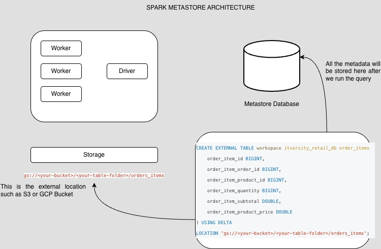

# Create and Review External Spark Metastore Table Using Delta Format

This guide compares managed and external tables, shows how to inspect table metadata, and practices loading JSON data into a Delta table. It uses the Unity Catalog names and paths from your example.

## Managed and external tables

A **managed table** is a table whose data storage and lifecycle are managed by Unity Catalog. You create and query it by its table name, such as `workspace.itversity_retail_db.orders`.

An **external table** is registered in Unity Catalog but points to a storage location that you specify. Unity Catalog manages its metadata and access, while the data files remain at that external location.

The key difference is who manages the table’s underlying storage and what happens to the data files if you drop the table. With a managed table, Unity Catalog manages the storage lifecycle. With an external table, the files remain at the external location when you drop the table registration.

## Check whether the previous table is managed or external

```sql
DESCRIBE FORMATTED workspace.itversity_retail_db.orders
```

This displays the table’s metadata. Review the provider and location details to understand how the table is stored. You can also use `DESCRIBE DETAIL` for Delta table details.

## Create an external table

For a Unity Catalog **external table**, `LOCATION` must be a cloud storage path, such as a `gs://...` path in GCP. That path must be covered by an **external location** configured in Unity Catalog. You can’t use your volume path (`/Volumes/...`) as the table’s `LOCATION`; volumes and tables cannot overlap.

```sql
CREATE EXTERNAL TABLE workspace.itversity_retail_db.order_items (
    order_item_id BIGINT,
    order_item_order_id BIGINT,
    order_item_product_id BIGINT,
    order_item_quantity BIGINT,
    order_item_subtotal DOUBLE,
    order_item_product_price DOUBLE
) USING DELTA
LOCATION 'gs://<your-bucket>/<your-table-folder>/orders_items';  -- example of external gcp bucket
```

The `LOCATION` value is an example placeholder. Replace it with a real GCS path covered by an external location in Unity Catalog before running the statement. The folder is where the external Delta table’s data is stored.

### Check that the external table is registered

```sql
-- Check that the external table is registered:
SHOW TABLES IN workspace.itversity_retail_db;

-- Check its storage location and table type:
DESCRIBE FORMATTED workspace.itversity_retail_db.order_items;
-- OR
DESCRIBE DETAIL workspace.itversity_retail_db.orders_items;
```

`SHOW TABLES` lists the tables registered in the schema. `DESCRIBE FORMATTED` and `DESCRIBE DETAIL` show metadata about a table, including storage-related details.

### List files at the external table’s cloud storage location

```bash
%fs ls gs://<your-bucket>/<your-table-folder>/orders_items/
```

This lists files at the cloud storage path if the workspace has permission to access it. `%fs` is a Databricks notebook command, so run it in a notebook cell.

## Create a managed table instead of an external table for `order_items`

Create a **managed table** instead of an external table for `order_items` for testing purposes. We don’t have a real **GCP bucket** for now because this is **Free Edition Databricks**, and I don’t want to use Databricks in any cloud yet.

```sql
CREATE TABLE workspace.itversity_retail_db.order_items (
    order_item_id BIGINT,
    order_item_order_id BIGINT,
    order_item_product_id BIGINT,
    order_item_quantity BIGINT,
    order_item_subtotal DOUBLE,
    order_item_product_price DOUBLE
) USING DELTA
```

Because no `LOCATION` is specified, Unity Catalog manages the table’s storage location. You refer to this table using its table name; you do not need to find or set its managed storage folder yourself.

### Review the managed table metadata

```sql
DESCRIBE FORMATTED order_items
```

This displays metadata for the table in the current catalog and schema context.

## Insert data with `INSERT INTO` or `COPY INTO`

### Use `INSERT INTO`

```sql
INSERT INTO workspace.itversity_retail_db.order_items
SELECT
    order_item_id,
    order_item_order_id,
    order_item_product_id,
    order_item_quantity,
    order_item_subtotal,
    order_item_product_price
FROM JSON.`/Volumes/workspace/default/retail_db/retail_db_json/order_items`
```

This reads rows from the JSON files at the volume path and inserts the selected columns into the existing `order_items` table. The selected columns should match the destination table’s columns in number, order, and compatible data type.

### Or use the `COPY INTO` method

```sql
COPY INTO order_items
FROM '/Volumes/workspace/default/retail_db/retail_db_json/order_items'
FILEFORMAT = JSON
```

`COPY INTO` loads data from the JSON files into the existing table. In this example, `order_items` is the target table and the volume folder is the source. The source volume path is separate from the storage location of the managed table.

## Validate the data

```sql
-- select all query
SELECT * FROM order_items

-- count the rows
SELECT count(*) FROM order_items
```

The first query displays the rows in the table. The second counts them, which is a quick way to confirm that data was loaded.

## Spark metastore architecture

The diagram below illustrates the Spark metastore architecture referenced in this lesson:


