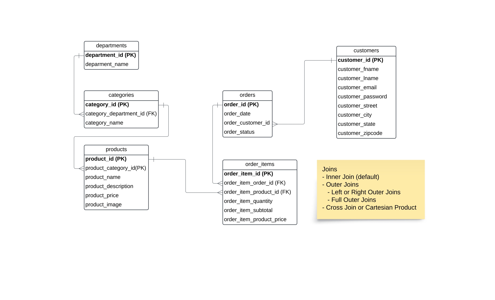

# Spark SQL Example Using Databricks

This walkthrough explores the retail sample data in a Unity Catalog volume, creates temporary views for orders and order items, and calculates revenue by date and product.

> **Data location used below:** `/Volumes/workspace/default/retail_db/retail_db`
>
> The examples assume the CSV files do not contain a header row. If yours do have headers, add `header 'true'` to the CSV options when creating each view.

## 1. Review the data model

The data model diagram shows how the retail tables relate. In this example, each order can have multiple order items. The `orders` view contains one row per order, and `order_items` contains the products and amounts within each order.



> Keep `Data_Model_Diagrams.jpg` in an `images` folder at the location expected by this relative path. If the image does not display, adjust the path to where you saved it.

---

## 2. Check the volume folder

Run this in a Databricks notebook cell:

```text
%fs ls /Volumes/workspace/default/retail_db/retail_db/
```

You should see folders such as `orders` and `order_items`. `%fs ls` is a Databricks notebook file command; run it in a notebook, not in Mac Terminal.

### Preview raw CSV lines

The `text` data source reads each line as plain text in one column named `value`. This is useful for a quick raw-file inspection, but it does not split CSV lines into fields.

```sql
SELECT *
FROM text.`/Volumes/workspace/default/retail_db/retail_db/orders/`
LIMIT 10;
```

To query named columns such as `order_id` and `order_status`, create the CSV views in the next section.

---

## 3. Create a temporary view for `orders`

A **temporary view** gives a name to the CSV data so you can query it with SQL. It is available during the current notebook session; it does not create a permanent table or copy the files.

```sql
CREATE OR REPLACE TEMPORARY VIEW orders (
  order_id INT,
  order_date STRING,
  order_customer_id INT,
  order_status STRING
)
USING CSV
OPTIONS (
  path '/Volumes/workspace/default/retail_db/retail_db/orders/',
  sep ','
);
```

The column definitions tell Spark the expected column names and data types. Spark applies them to the CSV fields by position.

### Check the view's columns and types

```sql
DESCRIBE orders;
```

`DESCRIBE` shows the view's column names and data types. To preview some rows, run:

```sql
SELECT *
FROM orders
LIMIT 10;
```

---

## 4. Create a temporary view for `order_items`

```sql
CREATE OR REPLACE TEMPORARY VIEW order_items (
  order_item_id INT,
  order_item_order_id INT,
  order_item_product_id INT,
  order_item_quantity INT,
  order_item_subtotal FLOAT,
  order_item_product_price FLOAT
)
USING CSV
OPTIONS (
  path '/Volumes/workspace/default/retail_db/retail_db/order_items/',
  sep ','
);
```

Check its columns and types:

```sql
DESCRIBE order_items;
```

Preview some rows:

```sql
SELECT *
FROM order_items
LIMIT 10;
```

---

## 5. Calculate revenue by date and product

**Revenue** is the total income a business earns from selling goods or services

Here, **revenue** means the sum of the order-item subtotals for completed or closed orders. The query joins order items to their order using the order ID, then groups by order date and product.

```sql
SELECT
  o.order_date,
  oi.order_item_product_id,
  ROUND(SUM(oi.order_item_subtotal), 2) AS revenue
FROM orders AS o
JOIN order_items AS oi
  ON o.order_id = oi.order_item_order_id
WHERE o.order_status IN ('COMPLETE', 'CLOSED')
GROUP BY
  o.order_date,
  oi.order_item_product_id
ORDER BY
  o.order_date,
  revenue DESC;
```

### What the query does

1. **JOIN** matches each order item to its order.
2. **WHERE** keeps orders whose status is `COMPLETE` or `CLOSED`.
3. **SUM** adds the item subtotals for each date and product.
4. **GROUP BY** produces one result row per date and product.
5. **ROUND** shows the result to two decimal places.
6. **ORDER BY** sorts dates first, then shows higher revenue first within each date.

This returns revenue **per product per order date**, not one overall revenue total. To calculate one total for the full period, remove the date and product columns and the `GROUP BY` clause.

## Notes

- If your notebook uses Python as its default language, select **SQL** for each SQL cell, or put `%sql` on the first line of the cell.
- The paths above use the Unity Catalog volume path. Volumes store files; the temporary views provide a convenient SQL name for querying those files.
- If you see a parsing error or unexpected values, check whether your CSV files have headers and whether every file in each folder has the same columns in the same order.
